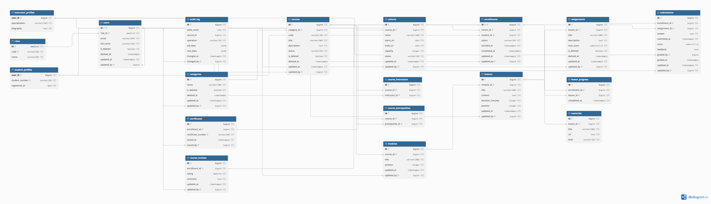

# Система управління навчальними курсами



## Мета

База даних призначена для навчального центру, який організовує курси, формує навчальні групи та контролює результати студентів. Вона дозволяє в одному місці:

- вести облік студентів, викладачів, категорій і курсів;
- створювати структуру курсу з модулів, уроків, матеріалів і завдань;
- призначати викладачів і зараховувати студентів до груп з обмеженою кількістю місць;
- враховувати попередні курси, які студент має завершити перед зарахуванням;
- зберігати прогрес навчання, відповіді на завдання, оцінки та відгуки;
- видавати сертифікати після виконання вимог курсу;
- зберігати історію змін і відновлювати записи після м'якого видалення.

## Технології

- PostgreSQL 16.
- Python 3.9 або новіший.
- `psycopg2-binary` для підключення Python до PostgreSQL.
- Repository + Unit of Work.
- DBML і dbdiagram.io для схеми бази даних.

## Таблиці та зв'язки

У схемі 19 таблиць і 34 зовнішні ключі.

Soft delete підтримують `users`, `categories`, `courses`, `assignments`: запис зберігається, а поля `is_deleted` і `deleted_at` позначають його як видалений.

Поля `updated_at` і `updated_by` мають `users`, `categories`, `courses`, `modules`, `lessons`, `cohorts`, `enrollments`, `assignments`, `submissions`, `course_reviews`. Тригери заповнюють час і користувача останньої зміни. Поля авторів змін посилаються на `users`; викладач, який оцінив роботу, посилається на `instructor_profiles`.

### Користувачі

| Таблиця | Призначення | Зв'язки |
|---|---|---|
| `roles` | Ролі: адміністратор, викладач, студент | 1:N з `users` |
| `users` | Ім'я, email і роль користувача | N:1 з `roles`; 1:0..1 з кожним видом профілю |
| `student_profiles` | Студентський номер і дата реєстрації | `user_id` є PK і FK до `users`; 1:N з `enrollments` |
| `instructor_profiles` | Спеціалізація й біографія викладача | `user_id` є PK і FK до `users`; N:M з курсами через `course_instructors` |

### Курси та навчальний вміст

| Таблиця | Призначення | Зв'язки |
|---|---|---|
| `categories` | Категорії курсів | 1:N з `courses` |
| `courses` | Код, назва, опис і стан курсу | N:1 з `categories`; 1:N з `modules`, `cohorts` |
| `course_instructors` | Призначення викладачів на курси | N:1 з `courses` та `instructor_profiles`; пара курс + викладач унікальна |
| `course_prerequisites` | Попередні курси, необхідні для зарахування | Два FK до `courses`; самопосилання та цикли заборонені |
| `modules` | Впорядковані розділи курсу | N:1 з `courses`; 1:N з `lessons` |
| `lessons` | Назва, вміст, тривалість і порядок уроку | N:1 з `modules`; 1:N з `materials`, `assignments` |
| `materials` | Посилання на документи, відео та інші матеріали | N:1 з `lessons` |
| `assignments` | Завдання уроку та максимальний бал | N:1 з `lessons`; 1:N з `submissions` |

### Навчання та результати

| Таблиця | Призначення | Зв'язки |
|---|---|---|
| `cohorts` | Групи курсу з датами та кількістю місць | N:1 з `courses`; 1:N з `enrollments` |
| `enrollments` | Зарахування студента до групи та стан навчання | N:1 з `cohorts`, `student_profiles`; пара група + студент унікальна |
| `submissions` | Відповідь, оцінка, коментар і викладач | N:1 з `enrollments`, `assignments`, `instructor_profiles` |
| `lesson_progress` | Завершені уроки конкретного зарахування | N:1 з `enrollments`, `lessons`; пара зарахування + урок унікальна |
| `certificates` | Номер сертифіката, дата й автор видачі | N:1 з `users`; не більше одного сертифіката на `enrollments` |
| `course_reviews` | Відгук випускника та рейтинг від 1 до 5 | Не більше одного відгуку на `enrollments` |

### Історія змін

| Таблиця | Призначення | Зв'язки |
|---|---|---|
| `audit_log` | Назва таблиці, ID запису, операція, час, автор, старі й нові значення в JSONB | N:1 з `users`; змінений запис визначається назвою таблиці та ID без універсального FK |

## Вимоги до системи

### Користувачі та історія змін

- Кожен користувач має одну роль. Адміністратор створює користувачів, категорії й курси та призначає викладачів.
- На початку транзакції застосунок передає ID автора через `sp_set_actor`. Тригери автоматично заповнюють `updated_at`, `updated_by` і журнал змін.
- ID передає довірений серверний застосунок після автентифікації. Сам `sp_set_actor` не є механізмом входу за паролем. Вебавтентифікація в цьому проєкті не реалізована.
- Застосунок змінює дані через збережені процедури, а читає через View. Додаткова роль `course_app` не має прямих прав на таблиці; для її використання виконується окремий скрипт налаштування прав.
- Користувачів, категорії, курси й завдання не видаляють фізично. Для них передбачені приховування та відновлення; прямий `DELETE` забороняється тригером.
- Курс з активними студентами приховати не можна, категорію з активними курсами також. Користувача не можна приховати за наявності активного навчання чи викладання.

### Курси

- Курс має унікальний серед активних записів код, категорію, назву, опис і стан.
- Адміністратор або призначений викладач додає модулі, уроки, матеріали й завдання до чернетки курсу.
- Опублікувати курс можна тільки за наявності хоча б одного уроку та призначеного викладача.
- Після публікації структура курсу фіксується. Назву й опис можна оновити, але додавати уроки та завдання до опублікованого курсу не можна.
- Передумови задаються окремими зв'язками між курсами. Циклічні залежності заборонені.

### Групи та зарахування

- Група має дати початку й завершення та місткість. Дата завершення не може бути ранішою за дату початку.
- Студент записується тільки до відкритої групи активного опублікованого курсу, дата завершення якої ще не минула.
- Для зарахування потрібно завершити всі попередні курси, зазначені в передумовах.
- Одного студента не можна двічі зарахувати до тієї самої групи. Повторне зарахування після скасування в цій версії не передбачене.
- При перевірці місць рядок групи блокується через `FOR UPDATE`, щоб дві паралельні транзакції не зайняли останнє місце одночасно.
- Скасоване зарахування звільняє місце. Завершені зарахування залишаються в історичній місткості групи.

### Завдання, оцінки та сертифікати

- Прогрес прив'язаний до конкретного зарахування. Урок і завдання мають належати його курсу.
- Студент надсилає тільки власну роботу. Для одного завдання в межах зарахування зберігається одна відповідь.
- Роботу оцінює призначений викладач. Бал не може бути від'ємним або перевищувати максимальний бал завдання.
- Для завершення курсу потрібно пройти всі уроки й отримати не менше 60% максимального бала за кожне активне завдання.
- Зміна стану навчання та видача сертифіката виконуються в одній транзакції. На зарахування видається не більше одного сертифіката.
- Після завершення студент може залишити відгук з оцінкою від 1 до 5. Повторне звернення оновлює наявний відгук.

## Процедури, функції та індекси

У схемі реалізовано 21 збережену процедуру, 9 функцій, 11 View і 32 тригери.

Основні процедури: `sp_create_course`, `sp_publish_course`, `sp_enroll`, `sp_submit`, `sp_grade`, `sp_finish_enrollment`, `sp_set_deleted`.

Функція `progress_percent` обчислює відсоток завершених уроків. Функції тригерів перевіряють належність навчального вмісту курсу, ведуть аудит і заповнюють поля останньої зміни.

Індекси двох типів:

- B-tree: унікальність кодів та email, пошук за зв'язками й історією. Часткові унікальні індекси враховують тільки активні записи.
- GIN: повнотекстовий пошук за назвою й описом курсу та пошук у JSONB журналу аудиту.

## Запуск

Потрібні запущений PostgreSQL 16 і Python 3.9 або новіший. З кореня проєкту:

```bash
createdb course_management
psql -d course_management -f sql/00_installation.sql
python3 -m venv .venv
source .venv/bin/activate
python -m pip install -r requirements.txt
export LMS_DSN="dbname=course_management user=YOUR_DB_USER host=localhost port=5432"
python -m app.demo
```

`YOUR_DB_USER`, сервер і порт потрібно замінити на свої. Пароль задається локально, наприклад через `.pgpass`, і не зберігається в репозиторії.

SQL-встановлення виконується один раз у порожню базу й не видаляє наявні дані. Демонстрацію можна повторювати: нові курси отримують унікальні коди.

Демонстрація послідовно виконує створення курсу з навчальним вмістом, зарахування студента, надсилання роботи, перевірку rollback, оцінювання, видачу сертифіката, відгук, soft delete та відновлення.

Для обмеженої серверної ролі адміністратор PostgreSQL додатково виконує:

```bash
psql -d course_management -f sql/08_app_role.sql
```

Після цього надає роль `course_app` довіреному серверному користувачу. View повертають дані для серверного застосунку; обмеження читання за конкретним студентом у цій версії немає.

## Структура

| Файл | Вміст |
|---|---|
| `sql/00_installation.sql` | Встановлення схеми, початкових даних і програмних об'єктів в одній транзакції |
| `sql/01_schema.sql` | Таблиці, ключі, обмеження та зв'язки |
| `sql/02_functions.sql` | Функції прогресу, аудиту та перевірок |
| `sql/03_triggers.sql` | Тригери аудиту, останньої зміни та бізнес-правил |
| `sql/04_views.sql` | View для читання курсів, зарахувань, робіт, сертифікатів та історії |
| `sql/05_procedures.sql` | Збережені процедури для операцій із сутностями |
| `sql/06_indexes.sql` | B-tree та GIN-індекси |
| `sql/07_seed.sql` | Початкові ролі, користувачі, профілі й категорії |
| `sql/08_app_role.sql` | Додаткове налаштування обмеженої ролі застосунку |
| `app/models.py` | Python-моделі даних |
| `app/repositories.py` | Репозиторії: читання через View, зміни через процедури |
| `app/unit_of_work.py` | Спільне з'єднання й транзакція для репозиторіїв |
| `app/demo.py` | Демонстраційні сценарії |
| `diagram/` | Схема PNG, DBML і генератор DBML зі структури БД |

Усі репозиторії використовують одну транзакцію Unit of Work. Без `commit()` або при помилці зміни відкочуються разом із відповідними записами аудиту. Після `commit()` з'єднання закривається, і наступні операції виконуються в новому Unit of Work.
